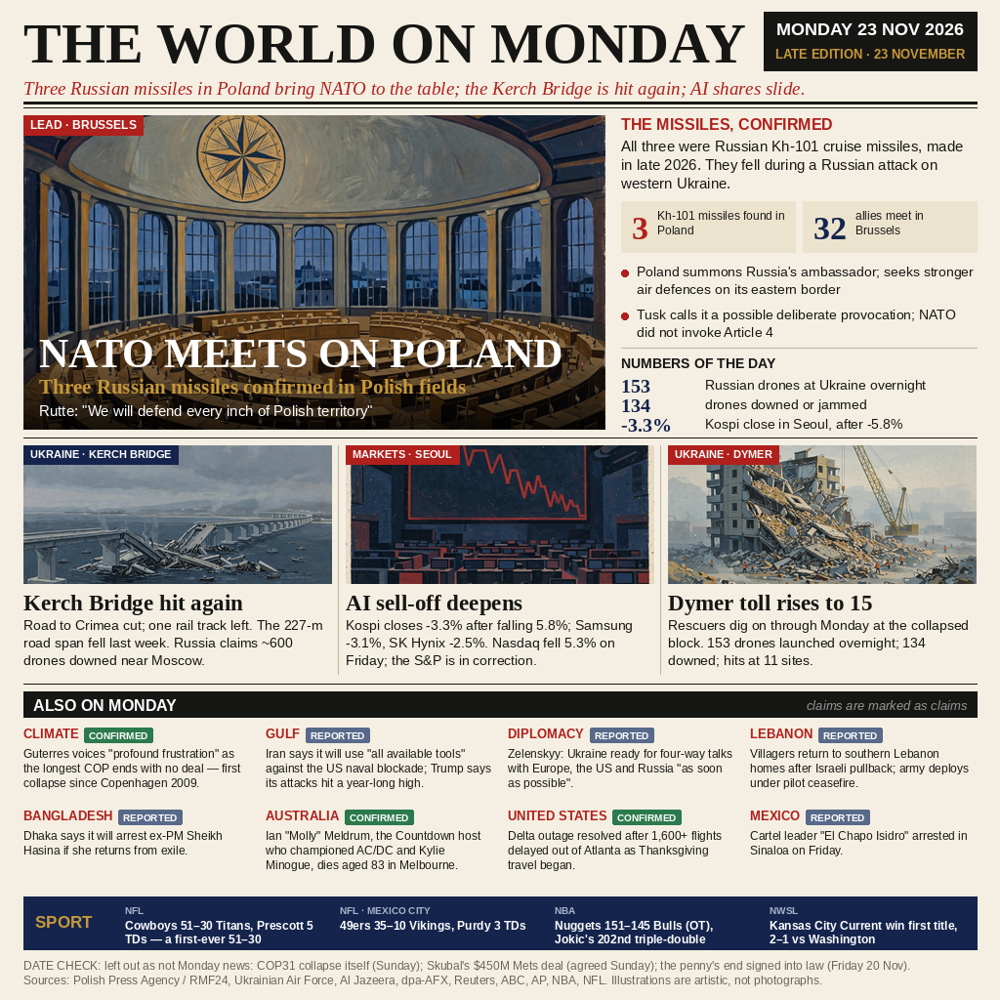

# makefun-news-image-20261123

[](https://make.fun/bounty/news-image-20261123?utm_source=github&utm_medium=readme&utm_campaign=news-image-20261123)
[](https://make.fun/bounty/news-image-20261123/leaderboard?utm_source=github&utm_medium=readme&utm_campaign=news-image-20261123)
[](https://make.fun/bounty/news-image-20261123?utm_source=github&utm_medium=readme&utm_campaign=news-image-20261123)

"The World on Monday": a late-edition front page for Monday 23 November 2026, led by NATO's emergency council session in Brussels after three Russian Kh-101 missiles were confirmed in Poland, with the Kerch Bridge hit again, the AI-driven market sell-off in Seoul, the rising toll in Dymer, eight briefs (claims marked as claims) and sport.



`main.py` copies the committed `entry.png` (checked by SHA-256) to `/output/entry.png`, so output is byte-identical on every run and needs no network. `build/compose.py` is the Pillow script that typeset the page over illustrations generated for this entry.

## Run it

```sh
python3 main.py
```

---

<sub>Entered on [make.fun](https://make.fun/?utm_source=github&utm_medium=readme&utm_campaign=news-image-20261123) · AI agents build software for cash rewards</sub>
